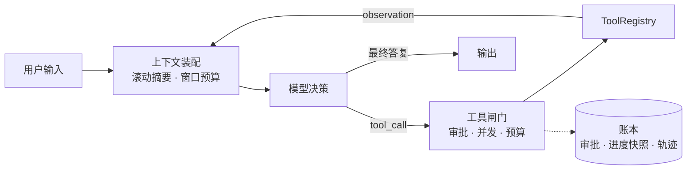

# ai_agent

[](https://github.com/Aoeht/agent/actions/workflows/ci.yml)
[](https://bun.sh)
[](https://modelcontextprotocol.io)

不依赖任何 agent 框架的通用 Agent 运行时，TypeScript + Bun。一套内核对外开三个入口：终端 REPL、Web 控制面板、多 Agent 团队。

[快速开始](#快速开始) · [能力](#能力) · [架构](#架构) · [仓库地图](#仓库地图) · [反诈风控应用](#反诈风控应用) · [评测](#评测) · [配置](#配置)

## 快速开始

需要 [Bun](https://bun.sh) 1.4.2 和一个 OpenAI 兼容的模型服务（地址 + Key）。

```bash
bun install
```

在项目根目录建 `.env`：

```bash
OPENAI_API_KEY=sk-xxxx
OPENAI_BASE_URL=https://api.deepseek.com/v1
```

```bash
bun run start
```

启动后列出已有会话，可续聊或新建；历史存在 `.agent-sessions/`，重启仍带着上文。

### 选一个入口

| 想做什么 | 命令 | 说明 |
|---|---|---|
| 终端对话 | `bun run start` | 单次任务：`echo "把 src/tools 列个清单" \| bun run start` |
| Web 控制面板 | `bun run src/server/main.ts` | 先 `cd web && bun install && bun run build`；默认 `127.0.0.1:8787` |
| 多 Agent 团队 | `bun run team "分析工作区代码并复核结论"` | 协调者拆解 → 并发执行 → 独立复核 |

可选依赖：`docker`（脚本沙箱隔离）、`TAVILY_API_KEY`（联网搜索）、embedding 服务（向量检索）。不配这些也能跑，对应能力自动降级。

### Web 控制面板

多会话并行、工具审批弹窗、计划面板，页头五个入口：

| 面板 | 作用 |
|---|---|
| **🖥️ 后台任务** | 任务列表、运行时长、退出码；stdout/stderr 按 900ms 增量尾随，运行中可直接终止 |
| **⏪ 检查点** | `/rewind` 的可视化入口：按回合回滚代码、对话或两者；回合进行中不可回滚 |
| **🧩 MCP 目录** | 浏览已挂载 server 的资源与提示模板；资源预览后注入下一轮，内容包在不可信围栏里 |
| **🕘 运行轨迹** | 把 `.traces/*.jsonl` 变成时间轴：回合、决策、工具调用、压缩与重试，点开看原始 JSON |
| **模型供应商** | 添加任意 OpenAI 兼容 API，请求按模型路由到对应端点与密钥；密钥只写本地 `providers.json`（0600） |

任务结束时服务器主动广播完成通知（成功、非零退出、超时、被终止都算），右下角弹卡片可跳回发起它的会话。

开发时改跑 `cd web && bun run dev`（Vite 5173，已代理到 8787）。

> [!IMPORTANT]
> 服务器默认只绑回环地址。绑非回环地址又没设 `AGENT_UI_TOKEN`（≥32 字符）会拒绝启动。

## 能力

| 能力 | 说明 |
|---|---|
| **[ReAct 内核](src/core/agent.ts)** | 流式 tool_call 完整性校验、迭代与 token 双预算、`parallelSafe` 工具并发（缺省串行） |
| **[MCP 接入](src/mcp/config.ts)** | 内置 filesystem server ⊕ 项目根 `.mcp.json`，改文件无需重启；资源与提示模板可注入 |
| **[混合检索 RAG](src/rag/)** | BM25 + 向量、查询改写、rerank、联网入库语义闸门；JSON 或 PostgreSQL 后端 |
| **[长期记忆](src/core/memory_store.ts)** | 四类事实、候选召回后关系判定（重复/补充/更新/冲突）、原子提交保留新旧版本 |
| **[子代理与团队](src/tools/delegate_task.ts)** | 只读白名单委派、重 DAG 并发执行 + 独立复核；子代理不含委派工具，无递归 |
| **[浏览器采证](src/tools/inspect_link.ts)** | Playwright 真浏览器取证、移动/微信形态、持久登录档、逐请求公网围栏 |
| **[沙箱执行](src/tools/run_script.ts)** | host 或 docker 一次性容器（默认断网）；`background:true` 跑长任务 |
| **[上下文治理](src/core/context_manager.ts)** | 滚动摘要、窗口覆盖、工具结果落盘回注、工具 schema 超水位才暴露的按需加载 |
| **[可观测与续跑](src/server/trace_viewer.ts)** | 轨迹时间轴、审批持久化、每轮进度快照、回合级检查点回滚 |

### 内置工具

| 工具 | 作用 | 需要 |
|---|---|---|
| `search_web` | 联网搜索 | `TAVILY_API_KEY` |
| `inspect_link` | 核查可疑链接，必要时起真实浏览器取证 | — |
| `rag_search` | 本地知识库混合检索 | 先导入语料 |
| `run_script` / `job_output` | 沙箱执行脚本 / 查看后台任务日志 | docker 可选 |
| `git_tree` | 只读查看仓库结构与提交图 | — |
| `read_image` | 图片直接进视觉通道，不走 base64 文本 | 模型支持图片 |
| `memory` | 跨会话记忆读写、冲突确认 | — |
| `delegate_task` / `team_task` | 只读子代理委派 / 重 DAG 团队 | `AGENT_DELEGATE=on` |
| `bili_pull` / `bili_collect` | 拉取视频快照 / 读快照做证据预处理 | `BILI_HUB_URL` / 本地快照 |
| `ingest_findings` / `record_pattern` | 扫描结论落库 / 经验卡草稿与转正 | — |
| `load_skill` | 按需加载技能正文 | 装了技能才有 |
| `ask_user` | 向人提问并等待回答 | — |
| `update_plan` / `read_task_state` / `set_acceptance_criteria` | 计划与验收条件 | — |
| `tool_search` | 按需加载元工具，超上下文水位后才对模型可见 | `AGENT_TOOL_SEARCH=auto` |
| `filesystem__*` | 来自 MCP filesystem server 的文件读写 | 限沙箱根内 |

REPL 与 Web 共用同一套斜杠命令：`/help` `/model` `/prompts` `/prompt` `/resources` `/resource` `/rewind` `/task*` `/tokens`。

## 架构



1. **装配上下文**：历史超窗口时滚动摘要压缩，工具结果过大则落盘、只回注路径与摘要。
2. **模型决策**：流式解析 tool_call，跨 chunk 拼装校验完整性，避免半截参数被执行。
3. **过工具闸门**：危险调用走审批（待审批状态入账本，进程重启后恢复提示），`parallelSafe` 工具进并发池，其余串行。
4. **回注观察**：每轮工具后写进度快照，崩溃续跑知道执行到哪；观察包在不可信围栏里。
5. **收敛或续跑**：命中迭代/token 预算则强制收尾，否则回到第 1 步。

## 仓库地图

| 路径 | 职责 |
|---|---|
| [`src/core/`](src/core/) | Agent 循环、上下文、记忆、任务与账本、供应商路由 |
| [`src/tools/`](src/tools/) | 内置工具实现 |
| [`src/mcp/`](src/mcp/) | MCP 客户端与 server 配置 |
| [`src/rag/`](src/rag/) | 入库、检索、改写、重排、向量后端 |
| [`src/frame/`](src/frame/) | 抽帧管道：窗口规划、确定性采样、九宫格拼图 |
| [`src/bili/`](src/bili/) | 快照、作者风控、评论选择、证据分页 |
| [`src/server/`](src/server/) | Web 后端、协议、轨迹查看器 |
| [`web/`](web/) | React 控制面板（独立 lockfile 与 tsconfig） |
| [`benchmarks/`](benchmarks/) | 评测脚本与标注集（不进 CI） |
| [`tests/`](tests/) | 104 个测试文件 |
| [`server/`](server/) | 采集侧只读 Hub 参考实现（Python） |

## 反诈风控应用

内核之上跑着一个垂直应用：对单个 B 站视频做诈骗风险扫描，输出 `video` / `author` / `comments` 三维度 + `overall` 综合结论，档位 `high` / `medium` / `low` / `clean` / `unknown`。

```
bili_pull 拉快照
  → 抽帧管道：大模型按 ASR/弹幕规划时间窗 → ffmpeg 确定性采样 → 九宫格
  → 视觉观察转文本并缓存
  → 评论树全量注入（楼中楼按根 rpid、父关系显式标注、正文转义隔离）
  → 作者维度：最近作品、规模与认证、风险历史、联系方式跨视频关联
  → 三维度判定 → ingest_findings 落库 → record_pattern 沉淀经验卡
```

scanner 是 `delegate_task` 的一个角色（不是独立 CLI），在对话里直接派：

```
用 scanner 扫一下 BV1xxxxxxxxxx
```

它拿的是扫描白名单（快照/链接/知识库/沉淀），墙钟默认放宽到 10 分钟。跑之前先备好知识库：

```bash
bun run rag:ingest --sync <反诈语料路径>
bun run eval:scanner --self-check                    # 零调用，验证解析与打分管道
bun run eval:scanner --live --dataset dataset --limit 5
```

判定纪律：判不了的维度填 `unknown`，不计入任何分母；疑似知识库未覆盖的新套路只打 `novel_pattern` 标记，不定性。经验卡走草稿→转正闭环：语义查重防重复、跨视频计数达标才转正、来源证据可审计。

评测口径与标注格式见 [`benchmarks/scanner/README.md`](benchmarks/scanner/README.md)。

## 评测

| 命令 | 评什么 | 成本 |
|---|---|---|
| `bun run eval:memory` | 记忆召回检索变体对照 | 零调用（合成向量） |
| `bun run eval:longmem --dataset <path>` | LongMemEval 检索层 | 缺省 keyword 零调用；`--mode real` 需 embedding 并产生费用 |
| `bun run eval:rag` | RAG 检索对照标注集 | 需已入库语料 |
| `bun run eval:scanner --self-check` | 诈骗扫描打分管道 | 零调用 |
| `bun run eval:frames` | 抽帧窗口覆盖率，visual/comment 分口径 | 需快照 |
| `bun run trace:report` | 聚合 `.traces/`：缓存命中、成本分布、工具错误率 | 需真实轨迹 |
| `bun run trace:view` | 单条委派轨迹的人读查看器 | 需真实轨迹 |

`benchmarks/` 下的脚本不进 CI：部分需要付费 API 或未入库的数据集。

## 配置

全部环境变量在 [`src/config.ts`](src/config.ts) 顶部有注释清单。常用的：

| 变量 | 默认 | 作用 |
|---|---|---|
| `OPENAI_API_KEY` / `OPENAI_BASE_URL` | — | 模型服务凭证（必填） |
| `AGENT_MODEL` | `deepseek-v4.1-flash-1017` | 主模型 |
| `AGENT_SUMMARY_MODEL` | `qwen3.6-plus` | 压缩 / 命名 / 记忆提取用的摘要模型 |
| `AGENT_MAX_TOTAL_TOKENS` | `500000` | 单次运行的 token 预算，`<=0` 不限 |
| `AGENT_MAX_TOOL_CALLS` | `40` | 单次运行的工具调用上限，`<=0` 不限 |
| `AGENT_MAX_ITERATIONS` | `0` | ReAct 迭代上限，`0` 表示不限（由预算兜底） |
| `AGENT_THINKING_EFFORT` | `default` | `off` / `low` / `medium` / `high` |
| `AGENT_CONTEXT_WINDOW` | 按模型名查表 | 覆盖上下文窗口，小窗口模型用 |
| `AGENT_SANDBOX` | `auto` | 脚本执行后端：`host` / `docker` / `auto` |
| `AGENT_TOOL_CONCURRENCY` | `4` | 同批 `parallelSafe` 工具的并发上限 |
| `AGENT_MEMORY_DIR` | `.agent-memory` | 跨会话记忆目录 |
| `AGENT_TRACE_DIR` | `.traces` | 运行轨迹目录 |
| `AGENT_JOB_DIR` | `.agent-data/jobs` | 后台任务目录（任务 JSON + 日志） |
| `AGENT_DATA_DIR` | 仓库根 `.agent-data` | 供应商配置目录，锚在代码目录、不随启动目录变化 |
| `AGENT_DELEGATE` / `AGENT_TEAM_TOOL` | `on` / `on` | 子代理委派与重 DAG 团队，可分别关闭 |
| `AGENT_UI_PORT` / `AGENT_UI_TOKEN` | `8787` / — | Web 端口与访问口令 |
| `EMBEDDING_BASE_URL` / `EMBEDDING_API_KEY` / `EMBEDDING_MODEL` | — | 向量检索；不配则只用关键词召回 |
| `BILI_HUB_URL` / `BILI_HUB_TOKEN` | — | 采集服务器地址与可选 Bearer 口令 |
| `BILI_DATASET_DIR` | `dataset` | 视频快照目录 |

MCP 服务器 = 内置默认（[`src/mcp/config.ts`](src/mcp/config.ts)）⊕ 项目根 `.mcp.json`（`AGENT_MCP_CONFIG` 可改路径），改文件无需重启。

<details>
<summary>知识库与长期记忆的运维细节</summary>

配置 embedding 后，本地文件、案例采集和联网结果在入库时生成文档向量，检索只编码查询。升级已有知识库或更换 embedding 配置后先补建向量：

```bash
bun run rag:embed
```

缺失向量不会在查询时自动补算，仍可通过关键词召回。入库向量化失败会保留正文，重跑导入或补建命令即可恢复。JSON 后端使用单个入库进程，多进程并发导入请选 PostgreSQL。

长期记忆的未确认冲突不注入有效记忆。用 `memory action=conflicts` 查看待确认提案，确认后用 `resolve` 处理；详见 [长期记忆演进](benchmarks/memory_recall/evolution.md)。

采集服务器侧的只读 Hub 参考实现见 [`server/bili_hub_api.py`](server/bili_hub_api.py)：直接读采集 sqlite，按 `bili-snapshot/v1` 提供列表与单视频快照，默认只监听 `127.0.0.1:8765` 并要求 Bearer 口令。

</details>

## 安全边界

> [!WARNING]
> 这是一个能读写文件、执行脚本、起真实浏览器并访问网络的 agent，不是安全沙箱产品。把它当成一个有你权限的自动化进程来对待。

- **脚本沙箱**：`AGENT_SANDBOX=docker` 时用一次性容器且默认断网（`AGENT_SANDBOX_NET=none`）；`host` 模式直接在宿主机跑，没有隔离。
- **文件访问**：MCP filesystem 工具限沙箱根内，但 `run_script` 在 host 模式下不受此限。
- **浏览器采证**：逐请求做公网围栏（内网地址一律 abort），关掉自动化标记只为通过站点风控。持久登录档（`INSPECT_BROWSER_PROFILE`）里存的是你的真实登录态，别提交进仓库。
- **提示注入**：外部内容（网页、MCP 资源、工具结果）包在不可信围栏里回注，但围栏是缓解措施而非保证。
- **审批**：危险调用需人工确认，待审批状态持久化，进程重启后恢复提示。

## 开发

```bash
bun run typecheck && (cd web && bun run typecheck) && bun test
```

CI 在 ubuntu 与 windows 双平台跑类型检查、web 构建与全量测试，全程不联网。

`bun test` 在同进程内并发跑所有测试文件，`process.env` 是共享的——需要改环境变量的用例要放在无 `await` 的同步块里，或给被测函数注入配置；异步收尾一律轮询等条件，不要固定 `sleep`。

## 已知限制

- 会话、记忆、轨迹、沙箱产物都落在项目根下并被 `.gitignore` 排除，仓库里不含任何对话数据。
- 技能是可选的：`.agents/skills/` 不存在时行为与未开启技能完全一致（不注册 `load_skill`）。
- 抽帧与 scanner 实跑依赖采集快照与已入库的反诈知识库，缺任一都会让可判维度退化。
- `eval:scanner --live` 逐个串行跑，几十条标注约数小时量级，建议 `--limit` 分批。
- 浏览器采证的持久登录档需要人工登录一次；会话级 cookie 靠档内 `state.json` 补回，该文件目前需手动导出。
